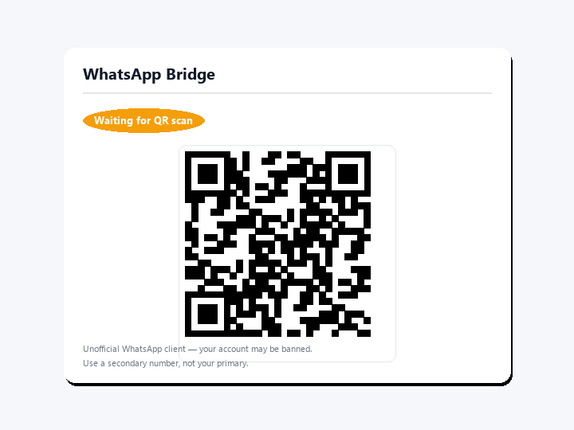
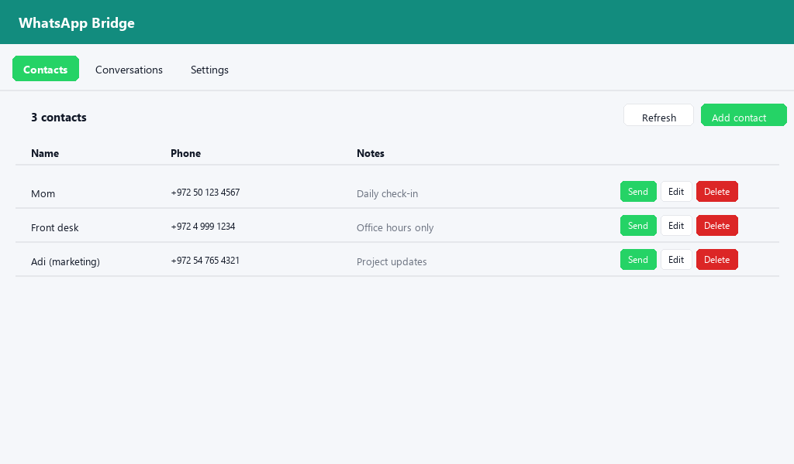

# WhatsApp Bridge

{ width="320" }

שליחה וקבלה של הודעות WhatsApp מתוך האוטומציות של Home Assistant.

!!! warning "לקוח WhatsApp לא רשמי"
    האינטגרציה מפעילה את [`whatsapp-web.js`](https://wwebjs.dev/) בתוך תוסף נלווה (add-on).
    תנאי השימוש של WhatsApp אינם מתירים שימוש אוטומטי (בוטים) בחשבונות אישיים, והחשבון שלכם
    עלול להיחסם, זמנית או לצמיתות. **השתמשו במספר טלפון משני ולא במספר הראשי.**
    בהתקנת האינטגרציה אתם מקבלים על עצמכם את הסיכון.

## מה מקבלים

- פלטפורמת התראות `notify.whatsapp`.
- שירותים: `send_text`, `send_media`, `send_location`, `contact_add`, `contact_update`,
  `contact_delete`, `session_logout`, `session_restart`.
- אירוע `whatsapp_message_received` להודעות נכנסות.
- חיישנים למצב החיבור, לסוללת הטלפון ולזמן ההודעה האחרונה, וחיישן בינארי לקישוריות.
- ישות `image` שמציגה את קוד ה-QR לצימוד.
- פאנל צד (**WhatsApp**) עם צימוד QR מובנה ופנקס כתובות.
- כרטיס Lovelace אופציונלי: `custom:whatsapp-qr-card`.

## תצוגה מקדימה

| כרטיס צימוד QR | פאנל פנקס הכתובות |
|---|---|
|  |  |

!!! note "הערה"
    התמונות הן הדמיות שנוצרו בסקריפט `docs/generate_assets.py` שבמאגר, ולא צילומי מסך אמיתיים.

## דרישות

- Home Assistant OS או Supervised.
- [התוסף WhatsApp Bridge](https://github.com/bareli/whatsapp-bridge-addon) רץ על אותו מארח.
- חשבון WhatsApp ומספר טלפון פנויים.
- Home Assistant בגרסה 2024.10.0 ומעלה (לפי `hacs.json`).
- ארכיטקטורות: amd64 ו-aarch64. Raspberry Pi 3 (armv7) אינו נתמך.

השלב הבא: [התקנה](install.md).
